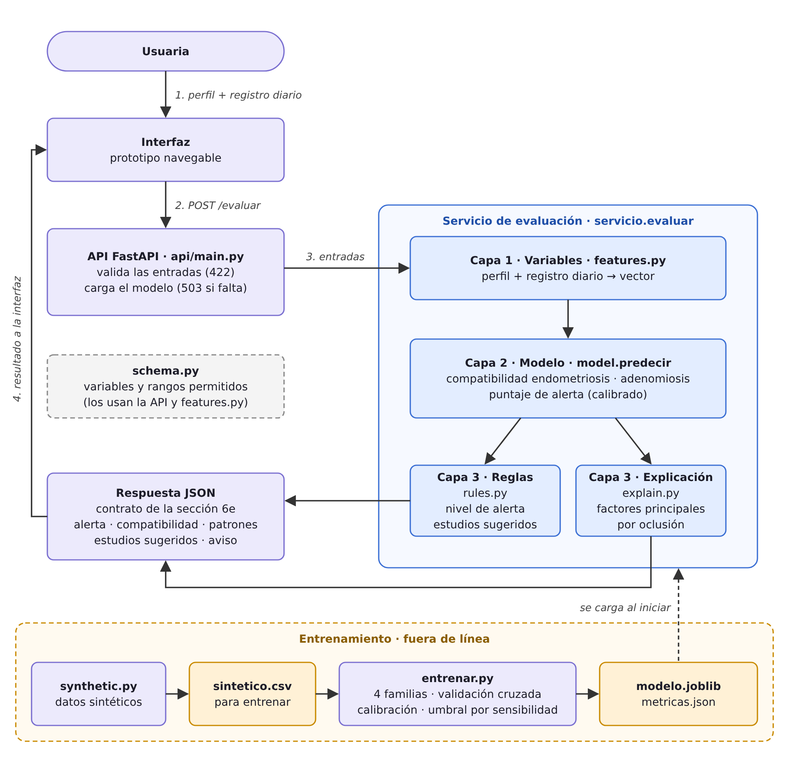
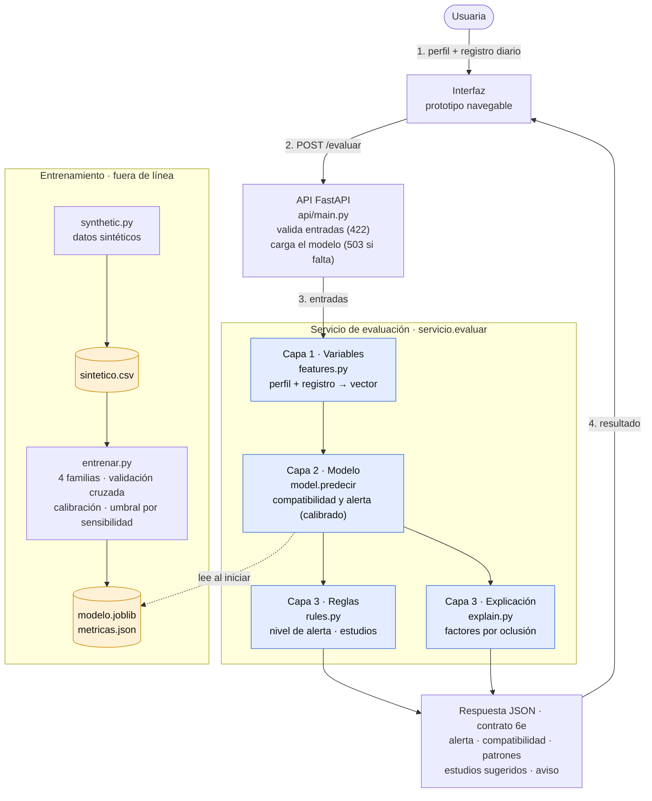

# Arquitectura de Astraea

Astraea recibe el perfil de una usuaria y su registro diario de síntomas, y devuelve una señal de alerta, la compatibilidad con endometriosis y adenomiosis, los patrones que más pesaron y los estudios que conviene llevar a consulta. Esta página resume cómo está organizado el código. El detalle metodológico está en las secciones 5 y 6 del documento.

## Diagrama (versión editable)

GitHub dibuja este bloque directamente. Los nodos no son clicables (GitHub desactiva los enlaces dentro de Mermaid); los enlaces a cada archivo están en la tabla de abajo.

## Componentes

| Componente | Qué hace | Archivo |
| --- | --- | --- |
| Interfaz | Prototipo navegable donde la usuaria llena su perfil y su registro diario | [`diseño/`](diseño/) · [`fuentes_diseño.md`](fuentes_diseño.md) |
| API | Recibe `POST /evaluar`, valida rangos y valores permitidos (422) y responde 503 si no hay modelo | [`api/main.py`](../api/main.py) |
| Esquema | Variables de entrada y rangos permitidos; lo usan la API y `features.py` | [`src/astraea/schema.py`](../src/astraea/schema.py) · [`data/DICCIONARIO.md`](../data/DICCIONARIO.md) |
| Servicio | Orquesta el flujo completo de una evaluación | [`src/astraea/servicio.py`](../src/astraea/servicio.py) |
| Capa 1 · Variables | Resume el perfil y el registro diario en un vector de variables clínicas | [`src/astraea/features.py`](../src/astraea/features.py) |
| Capa 2 · Modelo | Estima compatibilidad con endometriosis y adenomiosis y el puntaje de alerta, con probabilidades calibradas | [`src/astraea/model.py`](../src/astraea/model.py) |
| Capa 3 · Reglas | Define el nivel de alerta y los estudios sugeridos (borrador pendiente de revisión clínica) | [`src/astraea/rules.py`](../src/astraea/rules.py) |
| Capa 3 · Explicación | Calcula los factores principales por oclusión | [`src/astraea/explain.py`](../src/astraea/explain.py) |
| Datos sintéticos | Genera los datos de entrenamiento con parámetros supuestos por el equipo | [`src/astraea/synthetic.py`](../src/astraea/synthetic.py) · [`scripts/generar_datos.py`](../scripts/generar_datos.py) |
| Entrenamiento | Compara 4 familias de modelos, calibra, elige el umbral por sensibilidad y guarda el modelo | [`scripts/entrenar.py`](../scripts/entrenar.py) |
| Modelo y métricas | Resultado del entrenamiento que carga la API al iniciar | [`models/`](../models/) |
| Pruebas | Pruebas de variables, modelo, reglas y API | [`tests/`](../tests/) |

## Límites que conviene tener presentes

- El modelo se entrena con datos sintéticos: las métricas miden si el pipeline recupera los supuestos del generador, no la capacidad clínica.
- El resultado no es un diagnóstico y un resultado bajo no descarta la enfermedad; la respuesta lo indica en el campo `aviso`.
